 <!-- ========================================================= -->
<!--                  VEDANT MHATRE - PROFILE                  -->
<!-- ========================================================= -->

 

  

---

## About Me

I'm **Vedant Mhatre**, a Computer Engineering undergraduate specializing in Artificial Intelligence and Machine Learning at Vivekanand Education Society's Institute of Technology (VESIT), Mumbai.

My interests lie at the intersection of machine learning, scientific computing, and emerging computational paradigms. I enjoy developing intelligent systems that combine deep learning, graph representations, transformer architectures, and quantum computing.

- 🎓 B.E. Computer Engineering (Honors in AI & ML), VESIT.
- 📊 CGPA: **9.98/10** (up to Semester VI).
- 🧠 Research interests: Scientific ML, Transformers, Foundation Models, Quantum ML and Optimization.
- 🔬 Research experience at the Max Planck Institute for Psycholinguistics, Netherlands.
- 📄 Research accepted at **ICMLDE 2026 – Procedia Computer Science, Elsevier**.
- 🌍 Based in Mumbai, India.
- 💼 Available for a **6-month research internship (January–June 2027)**.

---

## Research Interests

| Research Area | Focus |
|:---:|:---|
| 🧠 Machine Learning | ML for scientific and engineering data |
| 🔤 Transformers | Foundation models and speech technologies |
| ⚛️ Quantum Computing | Quantum-enhanced ML and optimization |
| 🌐 Graph Learning | Spatiotemporal learning and graph neural networks |
| 🔬 Interdisciplinary AI | Applying deep learning to real-world scientific problems |

---

## Research Experience

### Max Planck Institute for Psycholinguistics, Netherlands

**Summer School Student / Research Intern** | May 2026 – July 2026

- Explored speech technology and automatic speech recognition for low-resource languages.
- Investigated fine-tuning Whisper on code-mixed Hindi-English speech.
- Benchmarked fine-tuning approaches against textual prompt injection.

### VESIT × Government Dental College & Hospital, Mumbai

**Computer Vision & Deep Learning Research Intern** | May 2025 – July 2025

- Led the deep learning pipeline for a forensic dentistry project involving human identification using postmortem dental radiographs.
- Developed an ensemble of EfficientNet-B0, EfficientNet-B3 and ConvNeXt.
- Achieved **74% Rank-1 and 90% Rank-5 accuracy**.

---

## Research Publications

📄 **A quantum-enhanced graph learning framework for edge-level traffic forecasting and QAOA-based congestion rerouting**

- Accepted at **ICMLDE 2026**.
- Publication: *Procedia Computer Science, Elsevier*.
- Scopus Indexed.

---

## Featured Projects

### 1. Forensodont – AI-Driven Dental Radiograph Matching

An AI-powered framework for forensic human identification using antemortem and postmortem dental radiographs.

- Led the OPG deep learning pipeline and IOPA matching methodology.
- Developed an EfficientNet-B1/B3 and ConvNeXt-Base ensemble.
- Integrated CNN representations with classical feature fusion.
- Achieved 74% Rank-1 and 90% Rank-5 accuracy.

### 2. STQGCN – Quantum Graph Learning for Traffic Forecasting

A spatiotemporal quantum graph convolutional network for edge-level traffic congestion forecasting and quantum-assisted rerouting.

- Integrated graph message passing with a Variational Quantum Circuit.
- Benchmarked against LSTM and classical STGCN architectures.
- Developed a Binary Particle Swarm Optimization rerouting baseline.
- Evaluated QAOA and classical optimization across 45 traffic scenarios.
- Contributed to a framework achieving 13–22% median peak-occupancy reduction.

---

## Technical Skills

### Programming Languages

### Machine Learning & Deep Learning

### Generative AI & Development

### Databases

### Quantum Computing

### Frameworks & Tools

---

## GitHub Statistics

  

---

## Contribution Activity

### Watch my contributions come alive!

---

## Achievements & Certifications

- 🏆 **Winner** – TechSprint Open Innovation Hackathon, GDG On Campus × Hack2Skill (2026).
- ⚛️ **Top 5** – QVolution Global Quantum Computing Hackathon, Girls in Quantum × Quandela (2026).
- 🎓 **Qiskit Advocate**, IBM Quantum – Co-organized Qiskit Fall Fest 2026 at VESIT.
- 📜 **80%** – NPTEL Quantum Computation and Quantum Information (2026).
- 🌐 **IELTS Academic: 8.5/9.0** – CEFR C2 (2026).

---

## Let's Connect!

I'm always interested in discussing research opportunities, collaborative projects, machine learning, quantum computing, and interdisciplinary applications of AI.

**Have an interesting research problem or project in mind? Let's connect!**

  

  

